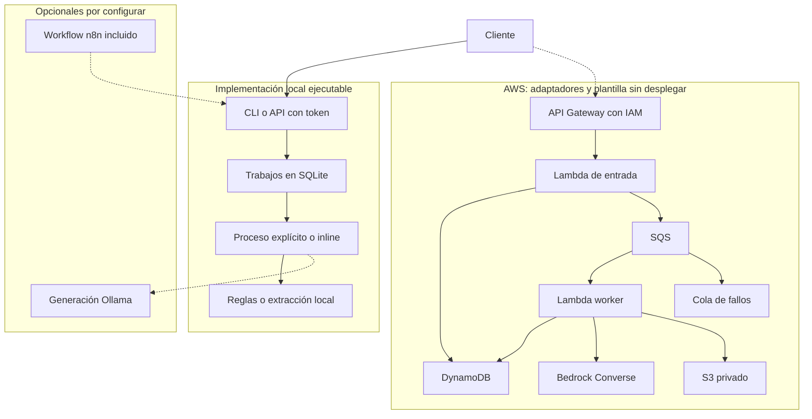

# Arquitectura

[Abrir SVG](diagrams/architecture.svg) · [Fuente Mermaid](diagrams/architecture.mmd)

Ofrece dos adaptadores del mismo ciclo de trabajos: ejecución local con SQLite y procesamiento asíncrono definido para AWS. La plantilla cloud conserva estados y limita la concurrencia del worker.

Versión Mermaid

Las líneas continuas muestran el recorrido implementado dentro de cada límite. Las líneas discontinuas indican componentes opcionales, entregados para configurar o aún por conectar; su estado se precisa en [tecnologías](technologies.md).

El API almacena primero el documento y su hash bajo una clave derivada del identificador de idempotencia. Sólo después publica el identificador en la cola. El cliente reintenta con la misma clave si falla la publicación. El worker reclama un lease de 100 segundos, invoca el modelo, escribe el resultado bajo una clave estable y marca el trabajo como completado.

El lease supera el timeout del worker (60 segundos); la visibilidad de la cola es 360 segundos. Un trabajo completado no vuelve a invocar el modelo. Una ejecución fallida devuelve `batchItemFailures` y deja el estado reintentable. Tras cinco entregas fallidas SQS dirige el mensaje a la DLQ.

La alternativa local persiste trabajos en SQLite y ejecuta el worker por acción explícita. No emula la infraestructura ni requiere boto3. La cola real sólo existe en AWS.

[Flujo de operación](flow.md) · [Tecnologías y alcance](technologies.md)
