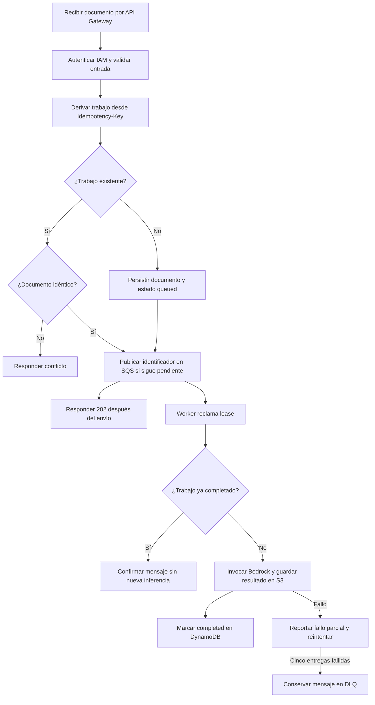

# Flujo de operación

[Abrir SVG](diagrams/flow.svg) · [Fuente Mermaid](diagrams/flow.mmd)

Versión Mermaid

- El diagrama de flujo describe el adaptador AWS entregado, no un despliegue ya ejecutado. En local: `submit` crea el trabajo, `process` lo ejecuta y `status` consulta el estado.
- Si falla el envío después de persistir, la API devuelve 503; el cliente debe reintentar con la misma clave para reparar esa ventana.
- El lease evita procesamiento simultáneo bajo los timeouts definidos. Un fallo posterior a la inferencia puede repetir inferencia y coste.

Los estados locales usan una transacción SQLite; el adaptador AWS usa escrituras condicionales y entregas de cola. Son mecanismos distintos con garantías de recuperación documentadas.

[Arquitectura](architecture.md) · [Tecnologías y alcance](technologies.md)
